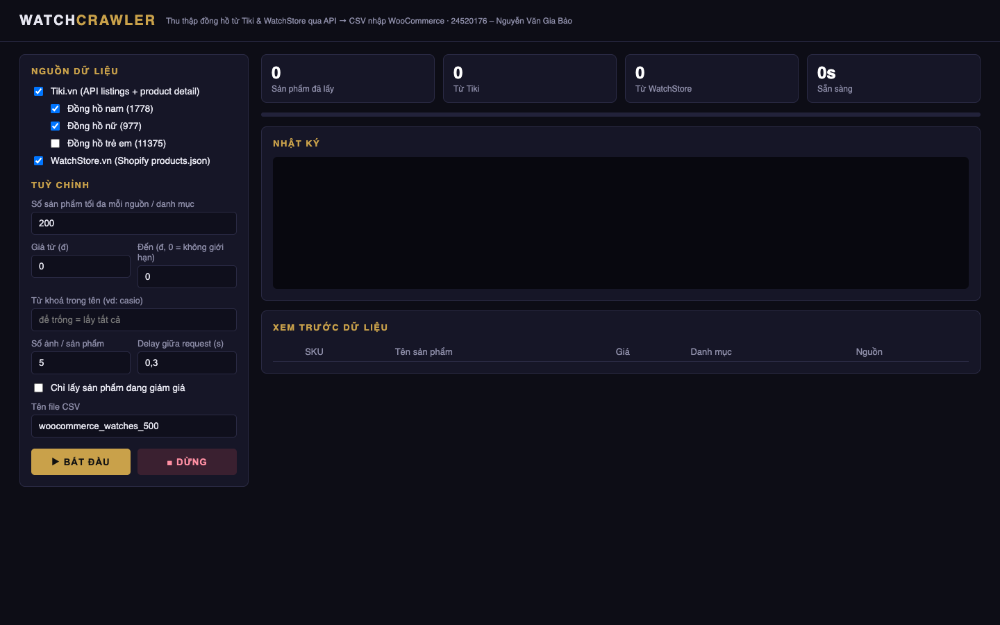
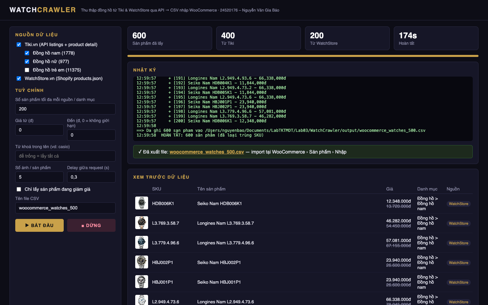
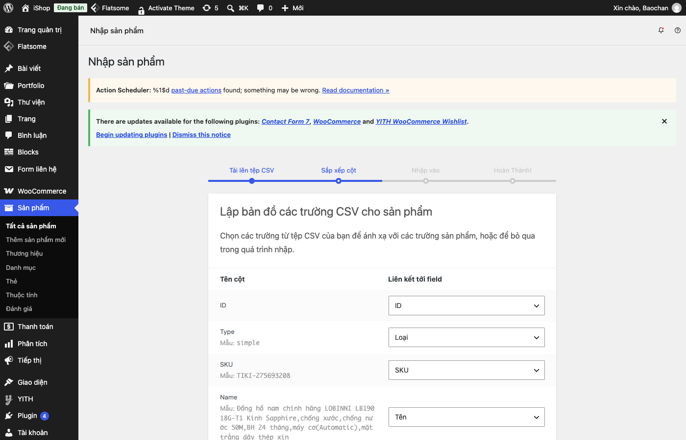
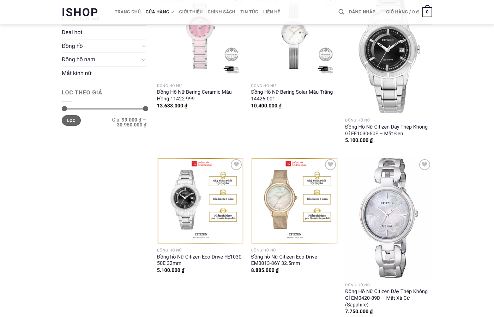

# WatchCrawler – Lab03 EC312 (24520176 – Nguyễn Văn Gia Bảo)

Crawler đồng hồ từ **Tiki** (API JSON) và **WatchStore.vn** (Shopify `products.json`), xuất CSV theo mẫu nhập sản phẩm WooCommerce.

```bash
python3 -m venv .venv && .venv/bin/pip install -r requirements.txt
# Giao diện web
.venv/bin/python src/app.py                      # mở http://127.0.0.1:5050
# Dòng lệnh
.venv/bin/python src/crawler.py --site all --limit 200 --out output/woocommerce_watches_500.csv
.venv/bin/python src/crawler.py --site tiki --category 1778 --limit 50 --keyword casio --min-price 1000000 --max-price 5000000
```
Tuỳ chọn: `--site`, `--category`, `--limit`, `--min-price`, `--max-price`, `--keyword`, `--only-sale`, `--max-images`, `--delay`, `--out`.

Kết quả: file CSV trong `output/` → WooCommerce › Sản phẩm › Nhập. Repo kèm 1 file mẫu `output/demo_terminal.csv`; chạy lệnh trên để tạo bộ đầy đủ (150 và 600 sản phẩm).

## Cấu trúc

```
src/
  crawler.py          crawler Tiki + WatchStore, xuất CSV (chạy được bằng dòng lệnh)
  app.py              giao diện web Flask gọi crawler.py
output/               file CSV kết quả (repo chỉ kèm 1 file mẫu)
docs/screenshots/     ảnh chụp giao diện, kết quả và lúc nhập vào WooCommerce
requirements.txt
```

## Ảnh chụp

| Giao diện web | Kết quả crawl |
|---|---|
|  |  |

| Nhập vào WooCommerce | Cửa hàng sau khi nhập |
|---|---|
|  |  |
